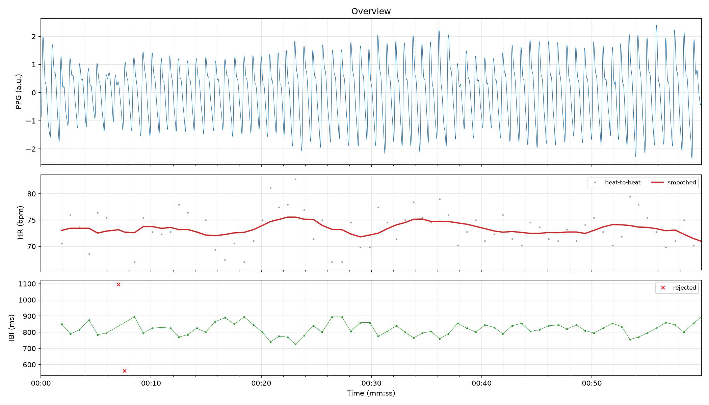
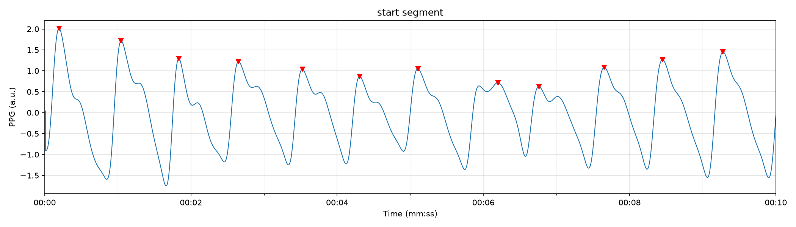
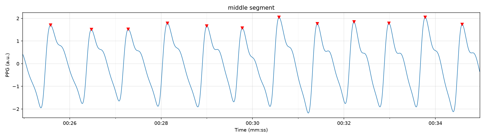
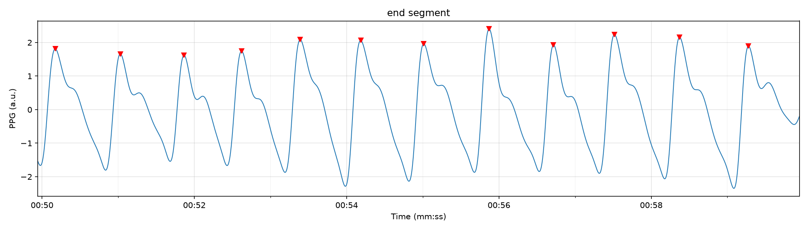
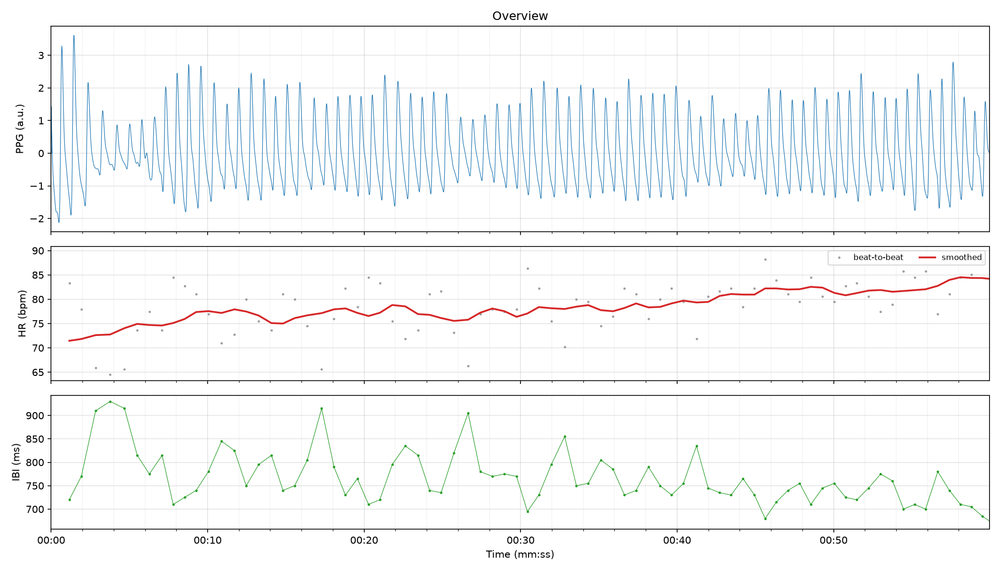
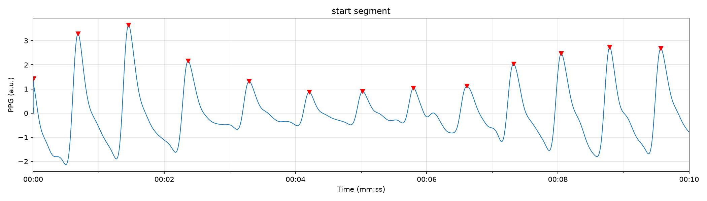
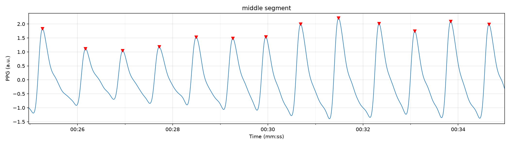
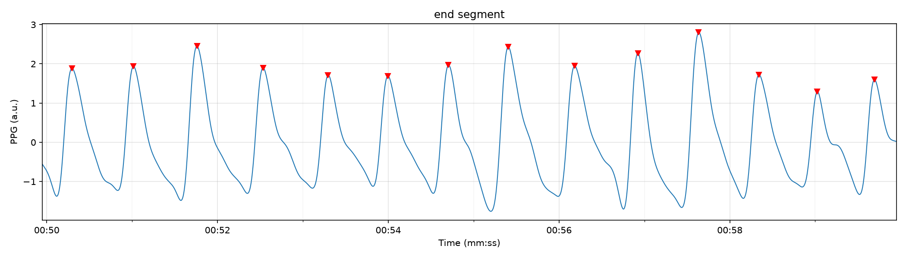
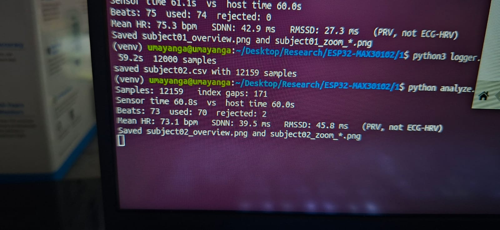
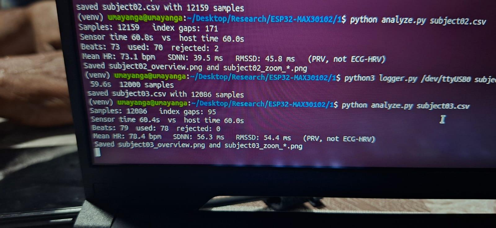

# ESP32 + MAX30102 PPG Research Logger

Records raw red/IR PPG data from a MAX30102 sensor using an ESP32, then analyzes it offline in Python (heart rate, SDNN, RMSSD, waveform plot).

## Files

| File | Purpose |
|---|---|
| `esp32_max30102_logger.ino` | ESP32 firmware, streams raw samples at 200 Hz over serial |
| `logger.py` | Saves the serial stream to a CSV file |
| `analyze.py` | Filters the signal, detects beats, computes metrics, plots the waveform |
| `data/` | Example recordings (`subject02.csv`, `subject03.csv`) |
| `results/` | Figures generated from the example recordings |

## Wiring

| MAX30102 | ESP32 |
|---|---|
| VIN | 3V3 |
| GND | GND |
| SDA | GPIO21 |
| SCL | GPIO22 |
| INT | GPIO19 (optional, not used by the current firmware) |

## 1. Upload the firmware

1. In Arduino IDE, install the library **SparkFun MAX3010x Pulse and Proximity Sensor Library**.
2. Select your ESP32 board and port.
3. Upload `esp32_max30102_logger.ino`.
4. Check the signal in Serial Plotter (921600 baud). IR should be about 50,000-200,000 with a visible pulse. If it reaches 262143, lower `ledBrightness`. If it is below about 20,000, raise it or check finger placement.
5. **Close the Serial Monitor/Plotter** before running the logger (only one program can use the port).

## 2. Python setup

```bash
python3 -m venv venv
source venv/bin/activate
pip install pyserial numpy scipy pandas matplotlib
```

On Windows, activate with `venv\Scripts\activate` instead.

## 3. Record data

```bash
python3 logger.py /dev/ttyUSB0 subject01 60
```

Arguments: `<serial port> <output name> <seconds>`. This saves `subject01.csv`.

- Linux port names: `/dev/ttyUSB0` or `/dev/ttyACM0`. Windows: `COM5`.
- If you get a permission error on Linux: `sudo usermod -a -G dialout $USER`, then log out and back in.

## 4. Analyze

```bash
python analyze.py subject01.csv
```

Useful options:

```bash
python analyze.py subject01.csv --no-show              # save PNGs only, no window
python analyze.py subject01.csv --window 15            # 15 s zoom windows
python analyze.py subject01.csv --start 30 --end 120   # analyze only 30 s to 120 s
```

Output: data-integrity check, signal-quality warnings, mean HR / SDNN / RMSSD, and PNG figures (`<name>_overview.png` plus start, middle and end zoom segments).

## Example results

Two 60-second recordings (200 Hz, MAX30102 IR channel, finger sensor, seated). Raw data is in `data/`, figures in `results/`.

| | subject02 | subject03 |
|---|---|---|
| Duration | 59.9 s | 60.0 s |
| Beats detected | 73 | 78 |
| Beats rejected (IBI outliers) | 2 | 0 |
| Mean HR | 73.1 bpm | 78.3 bpm |
| HR range (beat-to-beat) | 66-83 bpm | 65-90 bpm |
| SDNN | 39.5 ms | 56.4 ms |
| RMSSD | 45.8 ms | 54.4 ms |

SDNN and RMSSD here are from PPG pulse intervals (PRV), computed on a 60 s window. They are not ECG-HRV values, and 60 s is short for stable variability estimates.

### subject02

Overview: filtered PPG, beat-to-beat and smoothed HR, and inter-beat intervals (red x = rejected).



Zoomed segments (red triangles = detected beats):

| Start (0-10 s) | Middle (25-35 s) | End (50-60 s) |
|---|---|---|
|  |  |  |

- HR stays steady at about 71-76 bpm for the whole minute.
- The first ~10 s is the least clean: pulse amplitude falls and the waveform shape changes around 6-7 s, where the two rejected intervals (about 1100 ms and 560 ms) occur. This looks like a finger-settling artifact. From about 10 s onward the waveform is regular and the systolic peak, dicrotic notch and diastolic shoulder are clearly visible.

### subject03



| Start (0-10 s) | Middle (25-35 s) | End (50-60 s) |
|---|---|---|
|  |  |  |

- Smoothed HR drifts upward from about 71 to 84 bpm over the minute, and the intervals vary more than in subject02 (higher SDNN).
- The first ~8 s has large amplitude swings (peaks from about 3.6 down to 0.9) before the signal stabilizes. Discard or trim this settling period, for example with `--start 10`.

### Data-quality notes

- **Duplicate rows:** the CSVs contain repeated rows with identical idx, red and IR values (subject02: 170, subject03: 95). subject02 also has one genuinely missing sample (idx jumps by 2). `analyze.py` counts the duplicates as "index gaps" and its row-based sensor time reads slightly high (about 60.8 s vs 60.0 s host time). The numbers above were computed after dropping duplicates by `idx`, which removes the discrepancy (sensor time then matches host time).
- **Small pulsatile signal:** the raw IR range is narrow (subject03: 63,236-64,144 counts around a DC level of about 63,900). The waveform is clean, but a slightly higher LED brightness would give more signal amplitude.
- These are two short recordings from a breakout sensor, compared against a single cuff reading each (see below). That demonstrates the pipeline, but it is too few data points to establish measurement accuracy.

### Comparison with a reference device (Omron HEM-7120)

Each subject's pulse was also measured with an Omron HEM-7120 upper-arm blood pressure monitor, which reports pulse rate in beats per minute.

| | PPG (ESP32 + MAX30102) | Omron HEM-7120 pulse | Difference |
|---|---|---|---|
| subject02 | 73.1 bpm | 73 bpm | +0.1 bpm (0.1 %) |
| subject03 | 78.3 bpm | 78 bpm | +0.3 bpm (0.4 %) |

Mean absolute difference: 0.2 bpm.

<table>
<tr>
<th>subject02: Omron reading</th>
<th>subject03: Omron reading</th>
</tr>
<tr>
<td></td>
<td></td>
</tr>
<tr>
<td>Pulse 73 /min (SYS 132, DIA 74 mmHg)</td>
<td>Pulse 78 /min (SYS 84, DIA 58 mmHg)</td>
</tr>
</table>

How to read this comparison:

- Only the pulse rate is compared. The blood pressure values are shown because they are on the display, but they were not measured by this system.
- The PPG value is the mean over a 60 s recording. The Omron gives one number from a single cuff measurement, rounded to a whole bpm, at a slightly different time. subject03's heart rate drifted from about 71 to 84 bpm during the minute, so an agreement this close is partly luck of timing.
- Two subjects with one reading each cannot support error statistics. For a proper validation, record simultaneously against the reference and over many subjects and conditions, then report mean absolute error and Bland-Altman limits of agreement.

### Terminal output

Console output from the runs (the logger saving the CSVs, then `analyze.py`). The subject03 printout shows 78.4 bpm and the subject02 printout 73.1 bpm; the tables above use 78.3 bpm for subject03 because they are computed after removing duplicate rows (see data-quality notes).

<table>
<tr>
<th>subject02</th>
<th>subject03</th>
</tr>
<tr>
<td></td>
<td></td>
</tr>
</table>

## Recording tips

- Seated, still, finger relaxed with light, steady pressure.
- Avoid bright ambient light on the sensor.
- Record at least a few minutes per subject for stable HRV estimates.
- Keep the setup battery-powered or use a USB isolator when connected to a person.

## Research notes

- The MAX30102 is a breakout module, not a medical device.
- PPG gives pulse rate variability (PRV), which is not identical to ECG-based HRV.
- SpO2 from this module is uncalibrated and not suitable for clinical claims.
- Validate against a reference (ECG or certified pulse oximeter) and report error, for example with Bland-Altman analysis.
- Obtain ethics/IRB approval and informed consent before recording real subjects.
